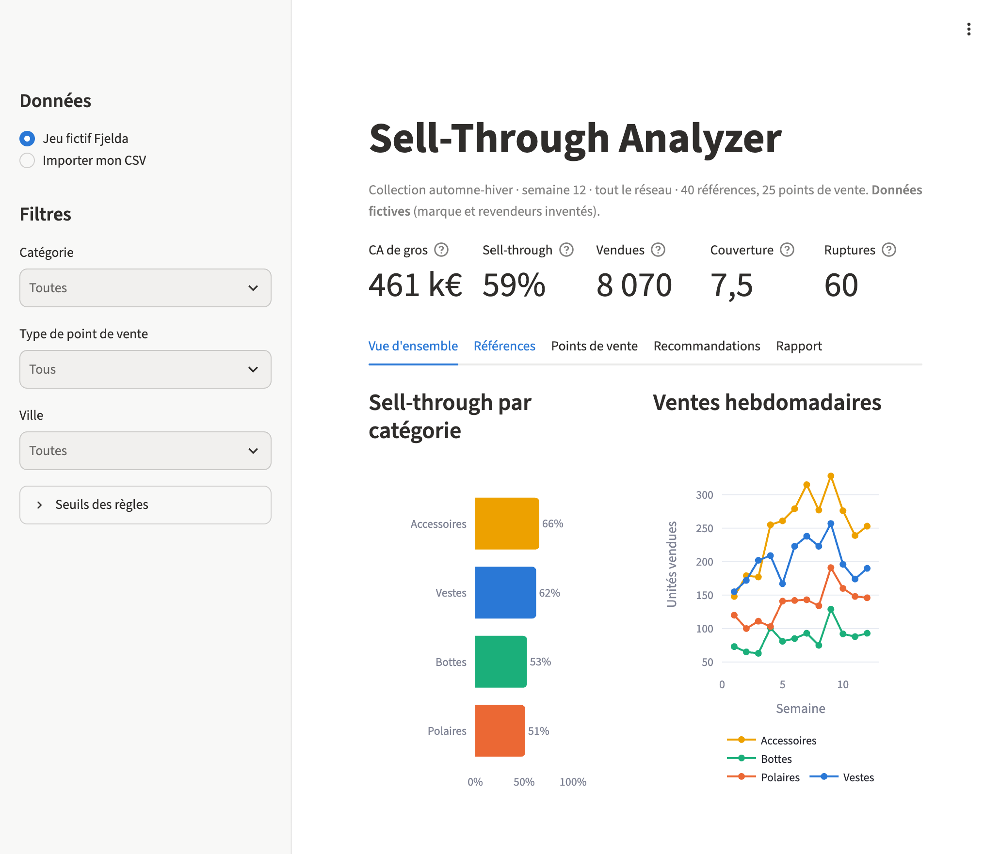
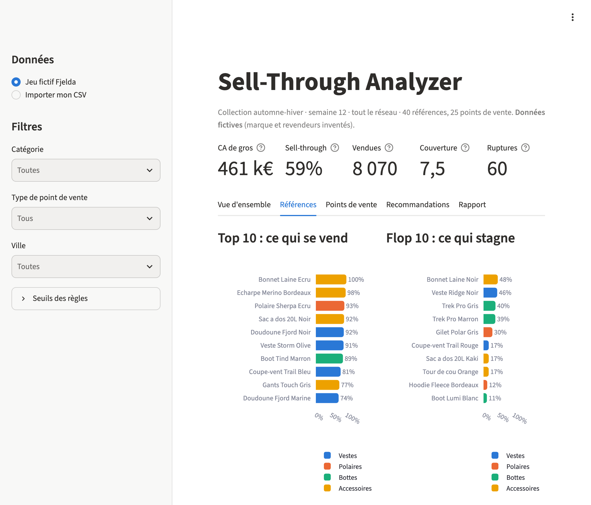
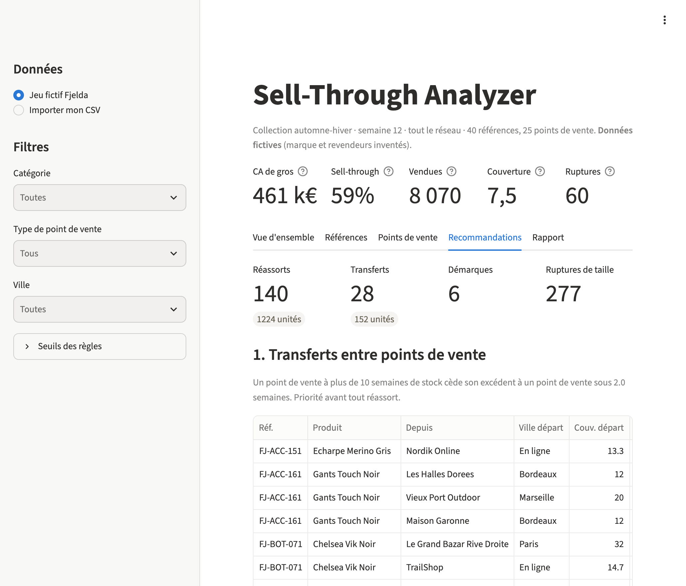

# Sell-Through Analyzer

**🇫🇷 Français** · [🇬🇧 English](#-english)

> ⚠️ **Toutes les données de ce projet sont fictives.** La marque « Fjelda », ses produits et ses revendeurs sont inventés. Le jeu de données est généré par simulation (`src/data.py`).



## Le problème métier

Après la mise en place d'une collection chez les revendeurs (multimarques, grands magasins, e-tailers), l'équipe wholesale doit savoir vite ce qui se vend, ce qui stagne, où réassortir et où déplacer du stock.
Ce suivi se fait souvent à la main sur Excel, référence par référence.
Cet outil le fait automatiquement à partir d'un simple export CSV des ventes et rédige une note de synthèse pour le directeur commercial.

## Ce que fait l'outil

| Étape | Détail |
|---|---|
| **Données** | Jeu fictif réaliste : 40 références (vestes, bottes, polaires, accessoires), 25 points de vente dans 8 villes, 12 semaines, tailles et couleurs. Best-sellers, références qui stagnent, ruptures de tailles centrales et saisonnalité (pic de froid en semaine 9). |
| **Import** | Chargement de son propre CSV au même format ([modèle vide](data/template.csv)), avec contrôle des colonnes et des valeurs. |
| **KPIs** | Sell-through par référence, point de vente et catégorie ; semaines de couverture ; ruptures ; top et flop 10 ; CA de gros. |
| **Règles** | Transferts entre points de vente, réassorts, démarques, alertes de rupture de taille. Seuils réglables dans l'interface. |
| **Synthèse IA** | Les KPIs agrégés (jamais les données brutes) sont envoyés à l'API Claude, qui rédige une note : constats, 5 actions prioritaires, risques. Sans clé API, tout le reste fonctionne. |
| **Interface** | Application Streamlit avec filtres (catégorie, type de point de vente, ville), graphiques interactifs, exports CSV, rapport en Markdown ou PDF. |




## Méthode de calcul des KPIs

| KPI | Formule |
|---|---|
| **Sell-through %** | unités vendues ÷ unités livrées, sur toute la période |
| **Rythme de vente** | ventes moyennes par semaine sur les 4 dernières semaines |
| **Semaines de couverture** | stock actuel ÷ rythme de vente (0 si plus de stock ; plafonné à 99 si le stock ne se vend plus) |
| **Rupture** | stock à 0 pour une référence dans un point de vente (toutes tailles) |
| **Rupture de taille** | une taille à 0 alors que d'autres tailles de la même référence restent en stock |
| **CA de gros** | unités vendues × prix de gros |

## Règles de recommandation

Elles sont appliquées dans cet ordre : on mobilise le stock déjà présent dans le réseau avant de réassortir.

1. **Transfert** : un point de vente à plus de 10 semaines de couverture cède son excédent (le stock au-delà de 6 semaines) à un point de vente sous 2 semaines qui vend encore la référence. Seuil minimal : 3 unités.
2. **Réassort** : sell-through ≥ 65 % et couverture < 3 semaines. Quantité = de quoi tenir 6 semaines, moins les unités déjà reçues en transfert.
3. **Démarque** : après 8 semaines, sell-through réseau < 30 % et plus de 12 semaines de stock. Démarque de 20 %, ou de 30 % si le sell-through est sous 15 %.
4. **Alerte taille** : courbe de tailles à revoir au prochain achat.

Tous les seuils sont dans [`src/config.py`](src/config.py) et modifiables depuis la barre latérale.

## Stack technique

Python 3.11 · pandas · Streamlit · Plotly · SDK `anthropic` (API Claude) · fpdf2 (PDF) · pytest

```
├── app.py              interface Streamlit
├── src/
│   ├── config.py       format des données et seuils des règles
│   ├── data.py         génération du jeu fictif et import CSV
│   ├── kpis.py         calcul des KPIs
│   ├── rules.py        recommandations par règles
│   ├── ai_report.py    synthèse via l'API Claude
│   └── export.py       rapport Markdown et PDF
├── data/               jeu fictif + modèle CSV vide
└── tests/              tests pytest des KPIs et des règles
```

## Lancer le projet en local

```bash
git clone https://github.com/Lumanito/sell-through-analyzer.git
cd sell-through-analyzer
python3 -m venv .venv
source .venv/bin/activate          # Windows : .venv\Scripts\activate
pip install -r requirements.txt

streamlit run app.py               # ouvre http://localhost:8501
pytest                             # lance les tests
```

**Synthèse IA (optionnelle)** : copier `.env.example` en `.env` et y coller une clé API Anthropic (`ANTHROPIC_API_KEY=...`). Le fichier `.env` est exclu de Git.

Pour régénérer le jeu de données fictif : `python -m src.data`.

## Limites

- Données simulées : les règles n'ont pas été calibrées sur un historique réel.
- Les réassorts sont calculés au niveau référence × point de vente, pas taille par taille.
- Pas de prise en compte des minimums de commande, des délais de production ou des coûts de transport.
- La note IA reformule des chiffres calculés par le code. Elle doit être relue avant d'être diffusée.

---

## 🇬🇧 English

> ⚠️ **All data in this project is fictitious.** The "Fjelda" brand, its products and its retailers are made up. The dataset is generated by simulation (`src/data.py`).

### The business problem

Once a collection is placed with retailers (multi-brand stores, department stores, e-tailers), the wholesale team needs to see quickly what sells, what doesn't, where to replenish and where to move stock.
This is often done by hand in Excel, one SKU at a time.
This tool automates it from a plain CSV sales export and drafts a summary memo for the sales director.

### What it does

- **Data**: realistic fictitious dataset (40 styles × colours, 25 doors in 8 cities, 12 weeks, sizes) with best-sellers, slow sellers, core-size stock-outs and seasonality. Users can also upload their own CSV using the [empty template](data/template.csv).
- **KPIs**: sell-through by style, door and category; weeks of cover; stock-outs; top and bottom 10; wholesale revenue.
- **Rule-based recommendations**: inter-store transfers, replenishment, markdowns, size-break alerts. All thresholds can be tuned in the sidebar.
- **AI summary**: only aggregated KPIs (never raw data) are sent to the Claude API, which writes a memo in French: findings, 5 priority actions, risks. Without an API key, everything else still works.
- **Interface**: Streamlit app with filters (category, door type, city), interactive charts, CSV exports and a Markdown or PDF report.

### KPI definitions

| KPI | Formula |
|---|---|
| Sell-through % | units sold ÷ units delivered |
| Rate of sale | average weekly units sold over the last 4 weeks |
| Weeks of cover | current stock ÷ rate of sale (capped at 99 when stock no longer sells) |
| Stock-out | zero stock for a style in a door (all sizes) |
| Size break | one size at zero while other sizes of the same style are still in stock |
| Wholesale revenue | units sold × wholesale price |

### Rules (applied in this order)

1. **Transfer**: doors above 10 weeks of cover give their excess stock (anything above 6 weeks of cover) to doors below 2 weeks that are still selling the style.
2. **Replenish**: sell-through ≥ 65% and cover < 3 weeks. Quantity = 6 weeks of cover minus units already received through transfers.
3. **Markdown**: after 8 weeks, network sell-through < 30% and cover > 12 weeks. 20% off, or 30% off below 15% sell-through.
4. **Size alert**: size curve to fix on the next buy.

### Run locally

```bash
git clone https://github.com/Lumanito/sell-through-analyzer.git
cd sell-through-analyzer
python3 -m venv .venv && source .venv/bin/activate
pip install -r requirements.txt
streamlit run app.py
pytest
```

Optional AI summary: copy `.env.example` to `.env` and add your Anthropic API key. `.env` is git-ignored.

### Stack

Python 3.11 · pandas · Streamlit · Plotly · `anthropic` SDK (Claude API) · fpdf2 · pytest

### Limitations

Simulated data; replenishment computed per style × door rather than per size; no order minimums, lead times or freight costs; the AI memo rephrases figures computed by the code and should be reviewed before sharing.
